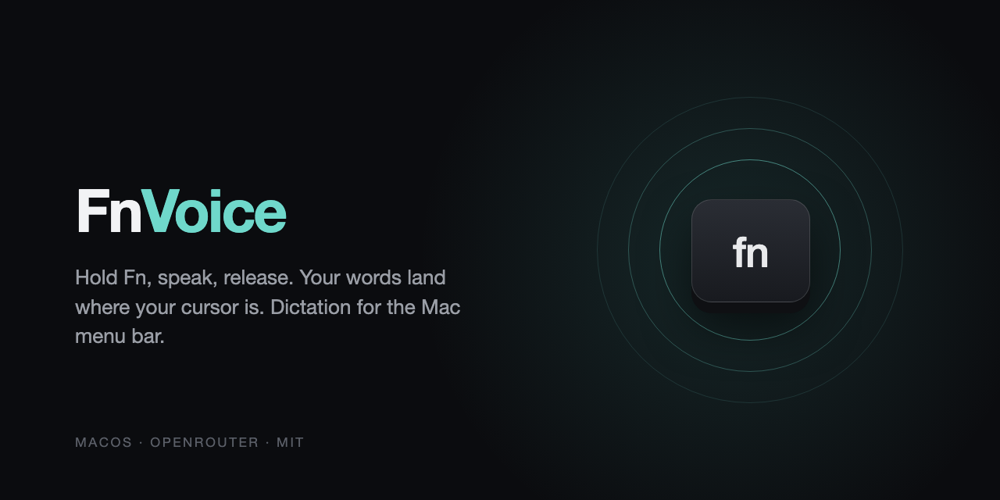

<p align="center"></p>

# FnVoice

*([English version](README.md))*

Une app macOS ultra simple pour transcrire ta voix en texte, directement depuis ta barre de menu.

Maintiens la touche **Fn** enfoncée, parle, relâche, et le texte apparaît là où se trouve ton curseur. C'est tout.

## Comment ça marche ?

1. L'app vit dans ta barre de menu (en haut à droite de ton écran)
2. Tu maintiens la touche **Fn** enfoncée
3. Tu parles
4. Tu relâches **Fn**
5. Le texte transcrit est automatiquement collé là où tu étais en train d'écrire

L'app passe par [OpenRouter](https://openrouter.ai) : tu choisis ton modèle de transcription parmi tous ceux proposés (AssemblyAI Universal-3.5 Pro par défaut). Elle apprend aussi ton vocabulaire au fil des dictées.

Ce dépôt est un fork amélioré de [Paseru/whisper](https://github.com/Paseru/whisper) (licence MIT), qui n'est plus maintenu. Le projet a été renommé pour éviter la confusion avec le modèle Whisper d'OpenAI.

## Installation

### Prérequis

- macOS 14 (Sonoma) ou plus récent
- Une clé API OpenRouter ([en créer une ici](https://openrouter.ai/keys))
- Pour compiler seulement : les outils en ligne de commande d'Apple

### Option 1 : télécharger l'app (la plus simple)

1. Va dans [Releases](../../releases/latest) et télécharge `FnVoice.zip`.
2. Décompresse-le et glisse **FnVoice.app** dans ton dossier **Applications**.
3. L'app n'est pas signée par Apple : au premier lancement, fais un **clic droit sur FnVoice > Ouvrir**, puis confirme. Si macOS affiche « endommagée », ouvre le Terminal et tape :
   ```bash
   xattr -dr com.apple.quarantine /Applications/FnVoice.app
   ```

### Option 2 : compiler toi-même

```bash
git clone https://github.com/MhmdEssB/fnvoice.git
cd fnvoice
bash build.sh --install
```

(Il faut les outils en ligne de commande d'Apple : `xcode-select --install`. Xcode n'est pas nécessaire ; tu peux aussi ouvrir `FnVoice.xcodeproj` dans Xcode.)

Ensuite :

4. **Configure ta clé API**
   - Clique sur l'icône FnVoice dans la barre de menu
   - Va dans les réglages
   - Entre ta clé API OpenRouter (commence par `sk-or-...`)

5. **Accorde les permissions**
   - **Microphone** : pour enregistrer ta voix
   - **Accessibilité** : pour coller le texte automatiquement

## Lancer FnVoice au démarrage du Mac

Pour que FnVoice se lance automatiquement quand tu allumes ton Mac :

1. Ouvre **Réglages Système**
2. Va dans **Général** > **Ouverture**
3. Clique sur le **+** en bas de la liste
4. Cherche et sélectionne **FnVoice** dans tes Applications
5. C'est bon !

Maintenant FnVoice sera toujours prêt à t'écouter dès que tu démarres ton Mac.

## Fonctionnalités

### Transcription instantanée
Maintiens **Fn**, parle, relâche. Le texte apparaît. Simple.

### Choix du modèle
Dans les réglages, choisis le modèle de transcription. La liste et les tarifs viennent d'OpenRouter et se mettent à jour tout seuls. Tu peux aussi choisir la langue parlée et n'accepter que des fournisseurs qui ne conservent pas les données.

Les dictées trop longues pour un modèle (2 minutes pour Universal-3.5 Pro) sont découpées automatiquement.

### Vocabulaire qui apprend
FnVoice transmet au modèle une liste de termes à reconnaître : les tiens, appris au fil du temps.

- Un sigle ou un mot technique dicté deux fois est ajouté tout seul
- Dans l'historique, le crayon permet de corriger une dictée : les mots corrigés sont retenus, et l'erreur est remplacée automatiquement les fois suivantes (« N-A-S-A » devient « NASA »)
- Le menu "Vocabulaire" permet d'ajouter ou de supprimer des termes et des corrections

### Historique (24h)
L'app garde un historique de tes transcriptions des dernières **24 heures**. Pratique pour retrouver un truc que t'as dicté plus tôt.

- Clique sur l'icône dans la barre de menu
- Sélectionne "Historique"
- Clique sur une transcription pour la copier

L'historique se nettoie automatiquement après 24h pour ne pas encombrer ton Mac.

### Feedback audio
Un petit son te confirme quand l'enregistrement commence et quand la transcription est prête.

## Permissions requises

L'app a besoin de ces permissions pour fonctionner :

| Permission | Pourquoi ? |
|------------|-----------|
| **Microphone** | Pour enregistrer ta voix |
| **Accessibilité** | Pour coller le texte automatiquement dans n'importe quelle app |

## Clé API OpenRouter

Tu as besoin d'une clé API OpenRouter pour utiliser FnVoice :

1. Va sur [openrouter.ai/keys](https://openrouter.ai/keys)
2. Crée un compte ou connecte-toi
3. Crée une nouvelle clé API
4. Copie la clé (elle commence par `sk-or-...`)
5. Colle-la dans les réglages de FnVoice

**Note** : L'utilisation est payante, mais la transcription coûte très peu (0,45 $ par heure d'audio pour Universal-3.5 Pro). Le tarif de chaque modèle est affiché dans les réglages.

Ta clé API est stockée de façon sécurisée dans le Keychain de macOS (le même endroit où sont stockés tes mots de passe).

## Comment ça fonctionne techniquement ?

1. Quand tu appuies sur **Fn**, l'app commence à enregistrer ton micro
2. L'audio est enregistré en format WAV (16kHz, mono)
3. Quand tu relâches **Fn**, l'audio est envoyé à OpenRouter, qui le transmet au modèle choisi
4. Le texte transcrit revient en quelques secondes
5. L'app simule un Cmd+V pour coller le texte là où tu étais

## Confidentialité

- **Audio** : Envoyé à OpenRouter et au fournisseur du modèle choisi, puis supprimé localement
- **Clé API** : Stockée dans le Keychain macOS (chiffré)
- **Historique** : Stocké localement, supprimé après 24h
- **Vocabulaire** : Stocké localement ; la liste des termes est jointe à chaque demande de transcription
- **Aucune télémétrie** : L'app n'envoie aucune donnée ailleurs qu'à OpenRouter pour la transcription

## Contribuer

Les PRs sont les bienvenues ! Si tu trouves un bug ou tu as une idée de feature, ouvre une issue.

## Licence

MIT. Fork de [Paseru/whisper](https://github.com/Paseru/whisper) (© 2024 Hyrak), voir [LICENSE](LICENSE).
