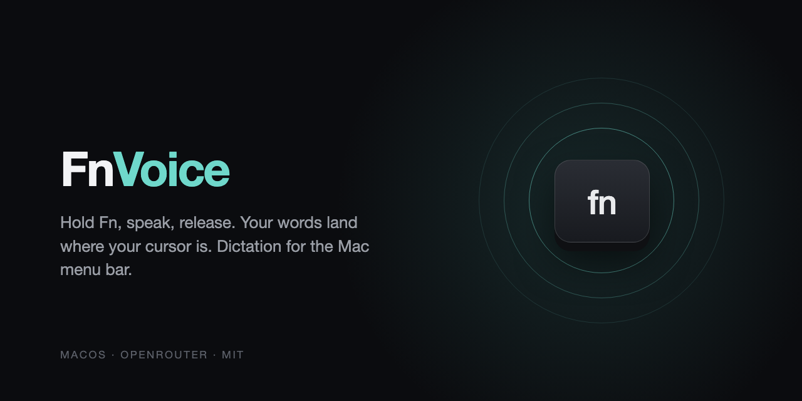

<p align="center"></p>

# FnVoice

Push-to-talk dictation for macOS. Hold the **Fn** key, speak, release, and the text is pasted where your cursor is. It lives in the menu bar and works in any app. *([Version française](README.fr.md))*

FnVoice sends your recording to [OpenRouter](https://openrouter.ai), so you pick the speech-to-text model you like (AssemblyAI Universal-3.5 Pro by default) and pay per minute of audio instead of a subscription. It also learns the acronyms, names and jargon you use, so they stop being misspelled.

It is a fork of [Paseru/whisper](https://github.com/Paseru/whisper), which is no longer maintained. The original was renamed to avoid confusion with OpenAI's Whisper model.

## Install

### Download the app

1. Open the [Releases](../../releases/latest) page and download `FnVoice.zip`.
2. Unzip it and drag **FnVoice.app** into **Applications**.
3. The app is not signed by Apple. On first launch, right-click it, choose **Open**, and confirm. If macOS says the app is damaged, run this in Terminal:
   ```bash
   xattr -dr com.apple.quarantine /Applications/FnVoice.app
   ```

### Or build it

```bash
git clone https://github.com/MhmdEssB/fnvoice.git
cd fnvoice
bash build.sh --install
```

You need Apple's Command Line Tools (`xcode-select --install`). Xcode is optional: you can also open `FnVoice.xcodeproj` in it.

### First launch

1. Click the FnVoice icon in the menu bar and open **Settings**.
2. Paste your OpenRouter API key. You can [create one here](https://openrouter.ai/keys). It starts with `sk-or-` and is stored in the macOS Keychain.
3. Allow **Microphone** (to record) and **Accessibility** (to paste the text). If you want to record meetings, also allow **System Audio Recording** when macOS asks for it.

To start FnVoice at login, add it in System Settings > General > Login Items.

Requirements: macOS 14 (Sonoma) or newer, and an OpenRouter key. Recording a meeting with the computer's sound needs macOS 14.2 or newer. With the default model, transcription costs about $0.45 per hour of audio. The proofreading pass adds about $0.0003 per dictation. Each model's price is shown in Settings.

## Features

- **Hold Fn to dictate.** A short sound confirms when recording starts and when the text is ready.
- **Any model, any language.** The model list and prices come from OpenRouter and refresh on their own. Pick the spoken language or let the model detect it. Long recordings are split automatically for models that limit audio length.
- **Vocabulary that learns.** A word or acronym you dictate twice is added automatically. Open the history and click the pencil to fix a dictation: FnVoice keeps the corrected words and applies the fix next time ("N-A-S-A" becomes "NASA"). You can also add terms by hand, or pre-load some in `FnVoice/Helpers/SeedVocabulary.swift` before building.
- **Proofreading with your vocabulary.** Speech models on OpenRouter do not accept a word list, so FnVoice adds a second step. A small model, Claude Haiku through OpenRouter (GPT-4.1 mini as a backup), rereads each dictation with your glossary, sorted by domain, and the recent dictations as context. It only replaces a word with a glossary term that sounds like it. A safety check rejects any other change, in which case only the local fixes are kept. The step adds about a second. You can turn it off with "Correct transcripts with my vocabulary" in Settings.
- **Meeting recording.** Records your microphone and the computer's sound (the other people in a call) together. The audio is cut into chunks of about 90 seconds, at silences, and four chunks are transcribed at a time. The result is a text file in `Documents/FnVoice Meetings`, with an optional summary of the discussion, decisions and actions at the top. If transcription fails, the recording is kept and the menu offers a retry.
- **Zero data retention, always on.** Transcription, proofreading and summaries only go through providers that keep neither your audio nor your text. Settings marks each model as compatible or "(incompatible)". Incompatible models are listed last, and choosing one makes OpenRouter refuse your dictations.
- **24-hour history.** Click a transcription to copy it. Entries are deleted after a day.
- **English and French.** The interface follows your system language.

## Privacy

- Audio goes to OpenRouter and the provider of the model you chose. Dictation audio is deleted from your Mac after transcription. Meeting audio is deleted once its transcript is written. It is kept only when transcription fails, so you can retry.
- Zero data retention applies to every request: transcription, proofreading and meeting summaries, Claude Haiku included.
- The vocabulary is stored locally. Its terms are sent with the proofreading request, not with the transcription request.
- Meeting transcripts are saved as text files in `Documents/FnVoice Meetings` on your Mac.
- The API key stays in the macOS Keychain.
- History and vocabulary are stored locally in `~/Library/Application Support/FnVoice/`.
- There is no telemetry. The only network traffic is to OpenRouter.

## Contributing

Issues and pull requests are welcome.

## Licence

MIT. FnVoice is a fork of [Paseru/whisper](https://github.com/Paseru/whisper) (copyright 2024 Hyrak). See [LICENSE](LICENSE).
