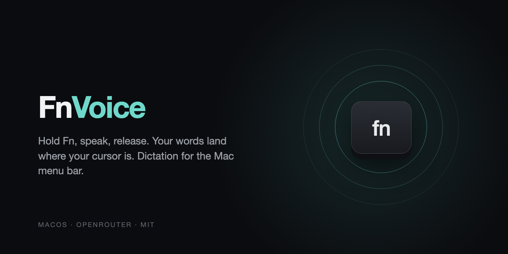

<p align="center"></p>

# FnVoice

Push-to-talk dictation for macOS. Hold the **Fn** key, speak, release, and the text is pasted where your cursor is. It lives in the menu bar and works in any app. *([Version française](README.fr.md))*

By default, FnVoice transcribes **on your Mac** with NVIDIA's Parakeet v3 model, running on the Neural Engine. It is free, it works offline, and your voice never leaves the computer. A 35-second dictation is transcribed in about 0.2 s on an M4 Mac, and an hour-long meeting in about ten seconds. If you prefer, you can switch to any online model on [OpenRouter](https://openrouter.ai), such as AssemblyAI Universal-3.5 Pro, and pay per minute of audio. FnVoice also learns the acronyms, names and jargon you use, so they stop being misspelled.

It is a fork of [Paseru/whisper](https://github.com/Paseru/whisper), which is no longer maintained. The original was renamed to avoid confusion with OpenAI's Whisper model.

## Install

### Download the app

1. Open the [Releases](../../releases/latest) page and download `FnVoice.zip`.
2. Unzip it and drag **FnVoice.app** into **Applications**.
3. The app is not signed by Apple. On first launch, right-click it, choose **Open**, and confirm. If macOS says the app is damaged, run this in Terminal:
   ```bash
   xattr -dr com.apple.quarantine /Applications/FnVoice.app
   ```

### Or build it

```bash
git clone https://github.com/MhmdEssB/fnvoice.git
cd fnvoice
bash build.sh --install
```

You need Apple's Command Line Tools (`xcode-select --install`). The first build downloads [FluidAudio](https://github.com/FluidInference/FluidAudio) through Swift Package Manager and takes a few minutes. The Xcode project does not include the on-device engine yet: use `build.sh`.

### First launch

1. Click the FnVoice icon in the menu bar and open **Settings**.
2. FnVoice downloads the Parakeet v3 model once (about 470 MB) and loads it. Settings shows the progress. After that, dictation works without a connection.
   An OpenRouter API key is optional. It is used for vocabulary proofreading, meeting summaries and online models. You can [create one here](https://openrouter.ai/keys). It starts with `sk-or-` and is stored in the macOS Keychain.
3. Allow **Microphone** (to record) and **Accessibility** (to paste the text). If you want to record meetings, also allow **System Audio Recording** when macOS asks for it.

To start FnVoice at login, add it in System Settings > General > Login Items.

Requirements: a Mac with Apple silicon (M1 or later) and macOS 14 (Sonoma) or newer. Recording a meeting with the computer's sound needs macOS 14.2 or newer. On-device transcription is free. Online models are billed by OpenRouter, for example about $0.45 per hour of audio for AssemblyAI Universal-3.5 Pro. The proofreading pass adds $0.04 to $0.68 per 1,000 dictations, depending on the model you pick. Each model's price is shown in Settings.

## Features

- **Hold Fn to dictate.** A short sound confirms when recording starts and when the text is ready.
- **On-device by default.** Parakeet TDT 0.6B v3 (NVIDIA, through [FluidAudio](https://github.com/FluidInference/FluidAudio)) recognises 25 European languages on its own, including English, French, Spanish, German and Italian, even when you mix them. It stays loaded in memory, so there is no wait when you press Fn. Recordings of any length are supported.
- **Or any online model.** The OpenRouter model list and prices refresh on their own. With an online model you can pick the spoken language or let the model detect it, and long recordings are split automatically for models that limit audio length. Use an online model for languages Parakeet does not cover, such as Arabic, Turkish or Chinese.
- **Vocabulary that learns.** A word or acronym you dictate twice is added automatically. Open the history and click the pencil to fix a dictation: FnVoice keeps the corrected words and applies the fix next time ("N-A-S-A" becomes "NASA"). You can also add terms by hand, or pre-load some in `FnVoice/Helpers/SeedVocabulary.swift` before building.
- **Proofreading with your vocabulary.** Speech models on OpenRouter do not accept a word list, so FnVoice adds a second step. A small, fast model rereads each dictation with your glossary, sorted by domain, and the recent dictations as context. It only replaces a word with a glossary term that sounds like it. A safety check rejects any other change, in which case only the local fixes are kept. The step adds about a second. You pick the model under "Review model" in Settings, each one shown with its price per 1,000 dictations, its speed and whether it is served with zero data retention: DeepSeek V4 Flash (default, fastest), Ling 3.1 Flash (cheapest), Mistral Small 3 or Claude Haiku 5.5. Reasoning is turned off so the answer comes back in about a second. If the chosen model is unavailable, FnVoice falls back to the next one. You can turn the step off with "Correct transcripts with my vocabulary".
- **Meeting recording.** Records your microphone and the computer's sound (the other people in a call) together. The audio is cut into chunks of about 90 seconds, at silences, and four chunks are transcribed at a time. The result is a text file in `Documents/FnVoice Meetings`, with an optional summary of the discussion, decisions and actions at the top. If transcription fails, the recording is kept and the menu offers a retry.
- **Zero data retention, always on.** Whatever goes online (online transcription, proofreading and summaries) only goes through providers that keep neither your audio nor your text. Settings marks each model as compatible or "(incompatible)". Incompatible models are listed last, and choosing one makes OpenRouter refuse your dictations.
- **24-hour history.** Click a transcription to copy it. Entries are deleted after a day.
- **English and French.** The interface follows your system language.

## Privacy

- With the default on-device model, audio never leaves your Mac. With an online model, audio goes to OpenRouter and the provider of the model you chose. Dictation audio is deleted from your Mac after transcription. Meeting audio is deleted once its transcript is written. It is kept only when transcription fails, so you can retry.
- Zero data retention applies to every request: transcription, proofreading and meeting summaries.
- The vocabulary is stored locally. Its terms are sent with the proofreading request, not with the transcription request.
- Meeting transcripts are saved as text files in `Documents/FnVoice Meetings` on your Mac.
- The API key stays in the macOS Keychain.
- History and vocabulary are stored locally in `~/Library/Application Support/FnVoice/`.
- There is no telemetry. The only network traffic is the one-time model download (from Hugging Face) and, if you set a key, OpenRouter.

## Contributing

Issues and pull requests are welcome.

## Licence

MIT. FnVoice is a fork of [Paseru/whisper](https://github.com/Paseru/whisper) (copyright 2024 Hyrak). See [LICENSE](LICENSE). The on-device engine uses [FluidAudio](https://github.com/FluidInference/FluidAudio) (Apache 2.0) and NVIDIA's [Parakeet TDT 0.6B v3](https://huggingface.co/nvidia/parakeet-tdt-0.6b-v3) model (CC BY 4.0).
